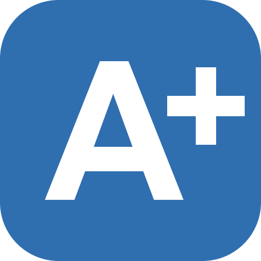

# Plan

My next ten years on one page: [plan.jaybulb.com](https://plan.jaybulb.com).

| When | What |
|---|---|
| 2026–27 | Pre-Calculus 12 online at LECSS |
| 2027 | KPU Langley, in person: writing, business math, intro business; then math and programming |
| 2028–31 | SFU Computing Science, Beedie Business minor |
| 2031 → | UBC: engineering and grad work |

## Files

- `index.html` — the page
- `plan.css` — the design system ([brand kit](https://plan.jaybulb.com/brand/))
- `brand/` — A+ mark and chapter glyphs
- `fonts/` — Plan Sans (Inter, OFL)

## Run

```
python3 -m http.server 8765    # preview
npx wrangler deploy            # ship
```
